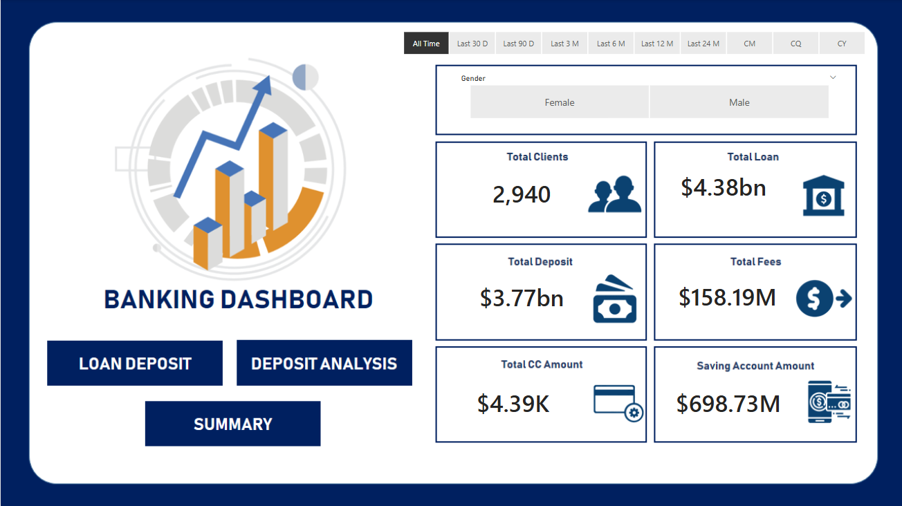
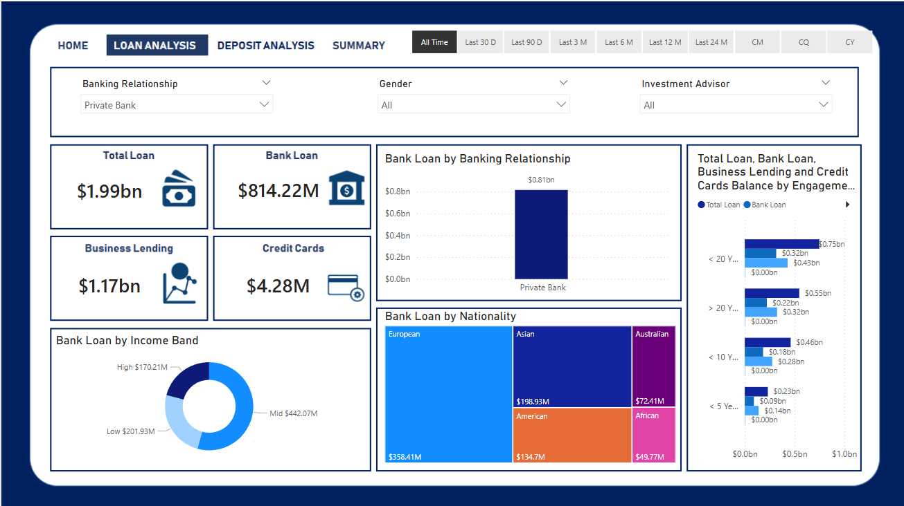
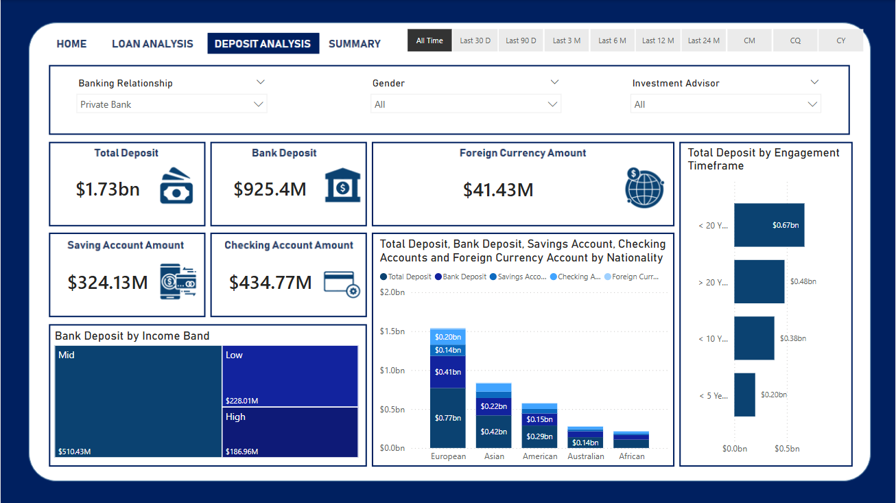
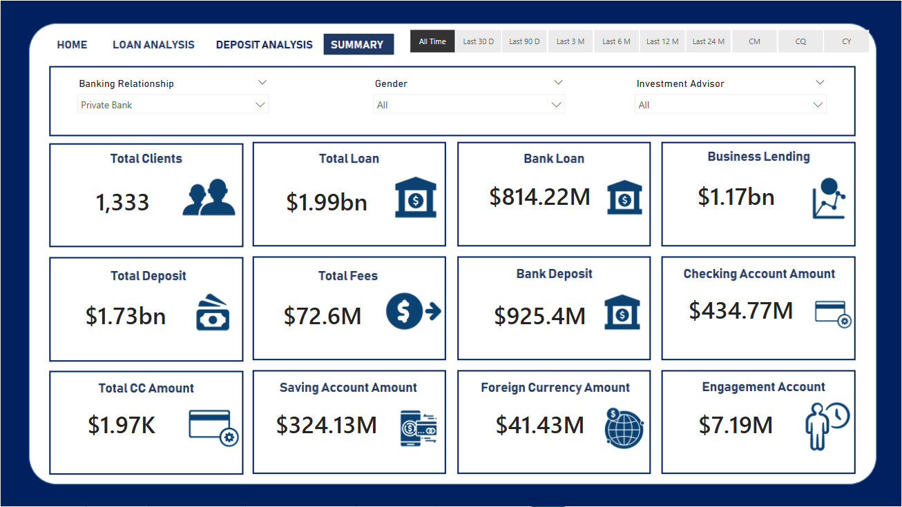

# Banking Customer Analytics

An end-to-end analysis of a 3,000-customer retail banking dataset. It covers preparing the data, exploring how customers hold money across products, and presenting the findings in an interactive four-page Power BI dashboard.

**Tools:** Python (Pandas, NumPy, Matplotlib, Seaborn) · Power BI · DAX · MySQL · SQL

## Workflow

Customer data (MySQL) → preparation → exploratory analysis (Python) → Power BI dashboard

## About the data

- **3,000 customers, 25 columns** (`data/Banking.csv`)
- Customer profile: age, nationality, occupation, loyalty class, fee structure, join date
- Finances: estimated income, superannuation savings, credit card balance, bank loans, deposits, checking, savings, foreign currency account, business lending, properties owned
- Coded fields (branch, gender, income band ID) that needed readable labels

## What I did

**1. Data preparation**
- Converted the join date to a proper date type and confirmed there were no missing values.
- Grouped estimated income into three bands: Low (up to 100K), Mid (100K to 300K) and High (over 300K). This gave 1,027 Low, 1,517 Mid and 456 High customers.
- In Power BI, replaced coded values with readable gender and branch names and standardized categorical fields.

**2. Exploratory analysis** (`eda/BankEDA.ipynb`)
- Summarized categorical fields such as nationality, occupation, fee structure and loyalty class.
- Compared the numeric measures with descriptive statistics, a correlation heatmap and scatter plots with fitted lines.

**3. Findings**
- Deposits, checking, savings and foreign currency balances are positively correlated, so customers who hold a lot in one product tend to hold a lot in the others. The strongest links are deposits with checking and deposits with savings.
- Age and income show moderate relationships with savings, superannuation and checking balances, which fits a typical earning and saving lifecycle.
- Property ownership is only weakly related to the banking variables, so it is probably driven by factors outside this dataset.
- Business lending is moderately linked to bank loans but barely related to deposits, which suggests it serves a separate group of customers.

## Dashboard

The Power BI report (`powerbi/Banking Dashboard.pbix`) has four pages.

**Home** gives an overview with headline numbers and key visuals.


**Loan Analysis** shows how loans are distributed across customer segments.


**Deposit Analysis** covers account balances, deposit types and how they relate.


**Summary** brings together the main findings and demographic patterns.


## Repository structure

```
├── data/
│   └── Banking.csv
├── eda/
│   └── BankEDA.ipynb
├── powerbi/
│   ├── Banking Dashboard.pbix
│   └── page1_home.png ... page4_summary.png
├── requirements.txt
└── README.md
```

## Run the notebook

```bash
pip install -r requirements.txt
jupyter notebook eda/BankEDA.ipynb
```

Run it from the project root so the data path resolves. If the notebook can't find `Banking.csv`, adjust the path in the first cell.
